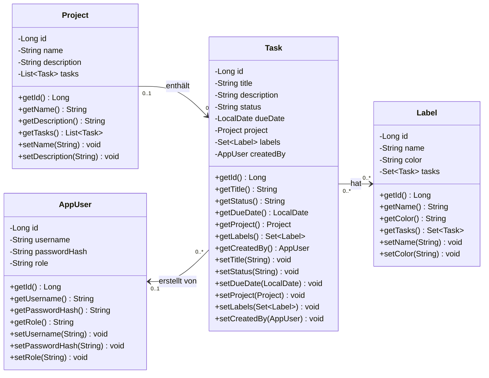

# UML-Klassendiagramm der Entitäten (Aufgabe 3.3)

Zum Exportieren als PNG/PDF: Code unten auf <https://mermaid.live> einfügen → *Actions* → *PNG/SVG*.

## Beziehungen

| Beziehung | Art | Umsetzung in der Datenbank |
|---|---|---|
| Project – Task | 1:n (eine Aufgabe gehört höchstens zu einem Projekt) | Fremdschlüssel `task.project_id` (nullable) |
| Task – Label | n:m | Join-Tabelle `task_label (task_id, label_id)` |
| Task – AppUser | n:1 (Ersteller der Aufgabe) | Fremdschlüssel `task.created_by_id` (nullable) |

Getter/Setter für `id` sind bei allen Klassen vorhanden und hier der Übersicht halber nur als `getId()` aufgeführt.
